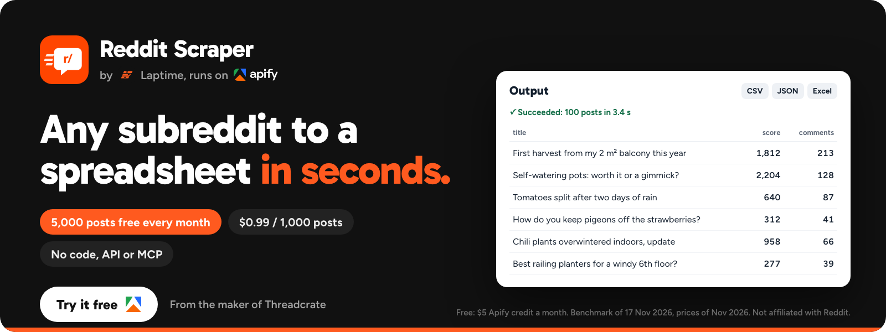
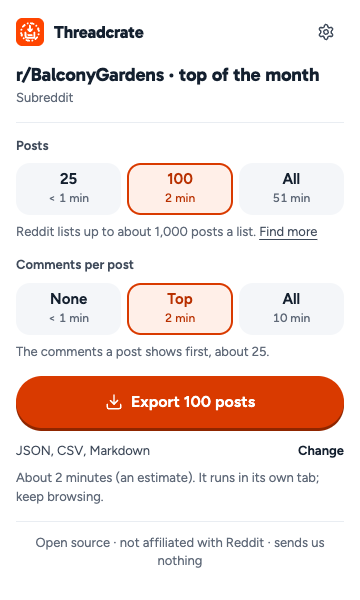
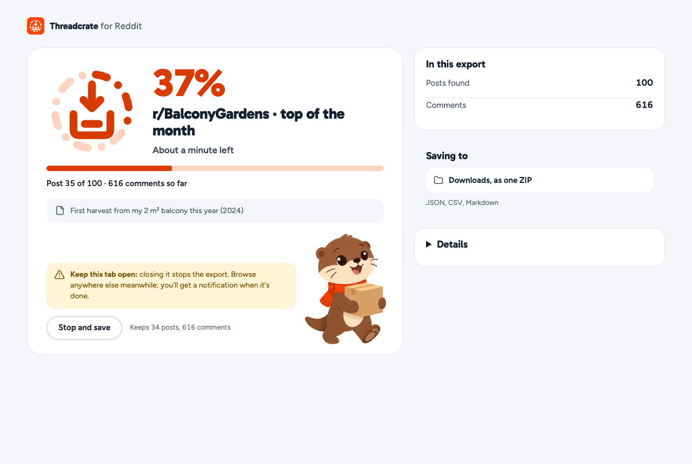
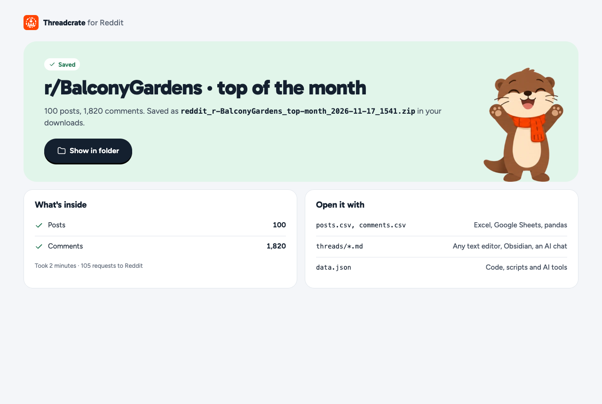

<p align="center">
  
</p>

<h1 align="center">Threadcrate for Reddit</h1>

<p align="center">
  Export Reddit threads with their comments, whole subreddits, profiles and searches to CSV, JSON and Markdown.<br>
  Free and open source. No account, no API key, nothing sent anywhere.
</p>

<p align="center">
  
</p>

It runs in your own browser and reads Reddit the way your browser does, at the pace Reddit allows. It talks only to Reddit, Reddit's media hosts and, for images linked there, Imgur. Not affiliated with or endorsed by Reddit.

## Want it in the cloud, or for your code and AI agents?

<p align="center">
  <a href="https://apify.com/laptime/reddit-scraper?utm_source=github&utm_medium=readme&utm_campaign=threadcrate"></a>
</p>

**[Reddit Scraper on Apify](https://apify.com/laptime/reddit-scraper?utm_source=github&utm_medium=readme&utm_campaign=threadcrate)** does what Threadcrate does, on a server: no tab to keep open, 100 posts in 3.4 seconds, and **5,000 posts free every month**.

**No code:** paste a subreddit, post, search or user, click **Start**, then **Export** to Excel, CSV or JSON.

<p align="center">
  <a href="https://apify.com/laptime/reddit-scraper?utm_source=github&utm_medium=readme&utm_campaign=threadcrate"></a>
</p>

**Your AI agent:** one line gives Claude Code live Reddit data (Cursor, VS Code and Claude Desktop work too):

```bash
claude mcp add reddit "https://mcp.apify.com?tools=laptime/reddit-scraper" -t http
```

<details>
<summary><b>Your code:</b> one API call, about $0.34 for 100 posts with 5 comments each</summary>

```bash
curl -X POST "https://api.apify.com/v2/acts/laptime~reddit-scraper/run-sync-get-dataset-items?format=csv" \
  -H "Authorization: Bearer $APIFY_TOKEN" \
  -H "Content-Type: application/json" \
  -d '{"startUrls":[{"url":"https://www.reddit.com/r/webscraping/"}],"maxPostCount":100,"maxComments":5}'
```

Python and JavaScript clients, schedules, webhooks, Make, Zapier and n8n are on the [actor's page](https://apify.com/laptime/reddit-scraper?utm_source=github&utm_medium=readme&utm_campaign=threadcrate).

</details>

<sub>Free: Apify's Free plan includes $5 of credit every month (no credit card), about 5,000 posts or 10,000 comments. After that, $0.99 per 1,000 posts and $0.49 per 1,000 comments, no start fee; prices as of 21 November 2026, benchmark from 17 November 2026. Threadcrate stays free and runs only in your browser.</sub>

## Install

<table align="center">
  <tr>
    <td align="center" width="300">
      <a href="https://chromewebstore.google.com/detail/nhgjbajgfmnpgodnmikmobfogdodbdgn"><br><b>Chrome Web Store</b></a><br>
      <sub>Chrome, Edge, Brave and other Chromium browsers</sub>
    </td>
  </tr>
</table>

Or build it yourself: `pnpm install && pnpm build`, open `chrome://extensions`, turn on Developer mode and choose **Load unpacked** → `.output/chrome-mv3`. A Firefox build exists (`pnpm build:firefox`) and comes to Firefox Add-ons later. Website: [threadcrate.jaspnerd.dev](https://threadcrate.jaspnerd.dev/).

## Why

Reddit closed most of its free API in 2026, and many export tools stopped working. Threadcrate reads the same pages reddit.com shows you, so it works logged out, and logged in it uses Reddit's API too, each within its own limit. The result is one ZIP you can open in Excel, read as Markdown or load in pandas, and keep.

## What you get

- **A thread with its comments:** every "load more" and "continue this thread" followed. Reddit's comment counts include removed comments it no longer shows anyone, so an export can have fewer than the number on the post; `manifest.json` lists what couldn't be loaded and why.
- **A whole subreddit**, any sort and time range: up to Reddit's 1,000 posts per list, or past that limit by reading eight lists (newest, top and controversial over several time ranges, hot) and keeping each post once.
- **Search results** and **user profiles** (profiles need you logged in to Reddit).
- **One ZIP:** `posts.csv` and `comments.csv` for spreadsheets, `data.json` with comment trees nested under their posts, a Markdown file per thread, and images and videos if you want them.
- Field names follow Reddit's own (`id`, `parent_id`, `created_utc`, `score`, `num_comments`), times are UTC, and deleted and removed comments stay in as `[deleted]` and `[removed]`, so replies keep their place. Spreadsheet cells never run a comment as a formula.

## How to use it

1. Open a post, a subreddit, a profile or a search on reddit.com.
2. Click **Threadcrate** in your browser's toolbar (or **Export** next to **Share** on a post, or <kbd>Alt</kbd>+<kbd>Shift</kbd>+<kbd>E</kbd>).
3. Pick how many posts and comments, each with how long it takes, and press **Export**.

A tab shows the export saving. Keep browsing; you get a notification when it's done, and **Show in folder** on the receipt.

| In the toolbar | While it saves | When it's done |
| --- | --- | --- |
|  |  |  |

## How fast

Reddit's request limit sets the pace, so the biggest choice is how many comments you need. **Top** takes the comments a post shows first, one request per post. **All** follows every reply, and a big thread can take hundreds of requests. In a test on 16 November 2026, a 741-comment thread took 2 minutes 9 seconds and exported 665 comments (the rest were removed comments Reddit no longer shows). Logged in, threads also come through Reddit's API, which runs on a separate allowance, so both go at once.

The pacing follows Reddit's `x-ratelimit-*` headers, never sends two requests to the same allowance at once, and always leaves a reserve so your own Reddit tabs keep working. More on how it reads Reddit: [docs/how-it-works.md](docs/how-it-works.md).

## Privacy and permissions

Nothing about you or your exports is sent to the developer or anyone else. Host access covers `www.reddit.com`, Reddit's media hosts (`*.redd.it`) and `i.imgur.com`; downloads saves the ZIP, notifications tell you when it's done, and storage remembers your choices. The [privacy policy](PRIVACY.md) explains each one.

## Known limitations

- Reddit lists at most about 1,000 posts per list. Going past that finds several thousand posts on a big subreddit, but never every old one.
- User profiles need you logged in to Reddit.
- Media is capped at 300 MB per file and 1.5 GB per export, because the ZIP is built in memory; anything beyond is listed in `manifest.json`.
- Logged in, Reddit serves a video's picture and sound as two files.

Something missing from an export? `manifest.json` in the ZIP says what couldn't be loaded and why. Still stuck: [report a problem](https://github.com/jasp-nerd/threadcrate/issues/new/choose).

## Use it responsibly

Export what you have a right to keep: your own posts, threads you take part in, research data you'll handle with care. Respect Reddit's [User Agreement](https://redditinc.com/policies/user-agreement) and the people who wrote the comments.

## Contributing

TypeScript and Svelte, built with [WXT](https://wxt.dev). `pnpm install`, `pnpm dev`, and `pnpm verify` before a change is done. See [CONTRIBUTING.md](CONTRIBUTING.md). From the maker of [Canvas Course Downloader](https://coursedownloader.com).

## License

[MIT](LICENSE). Reddit is a trademark of Reddit, Inc. This is an independent project, not affiliated with or endorsed by Reddit.
